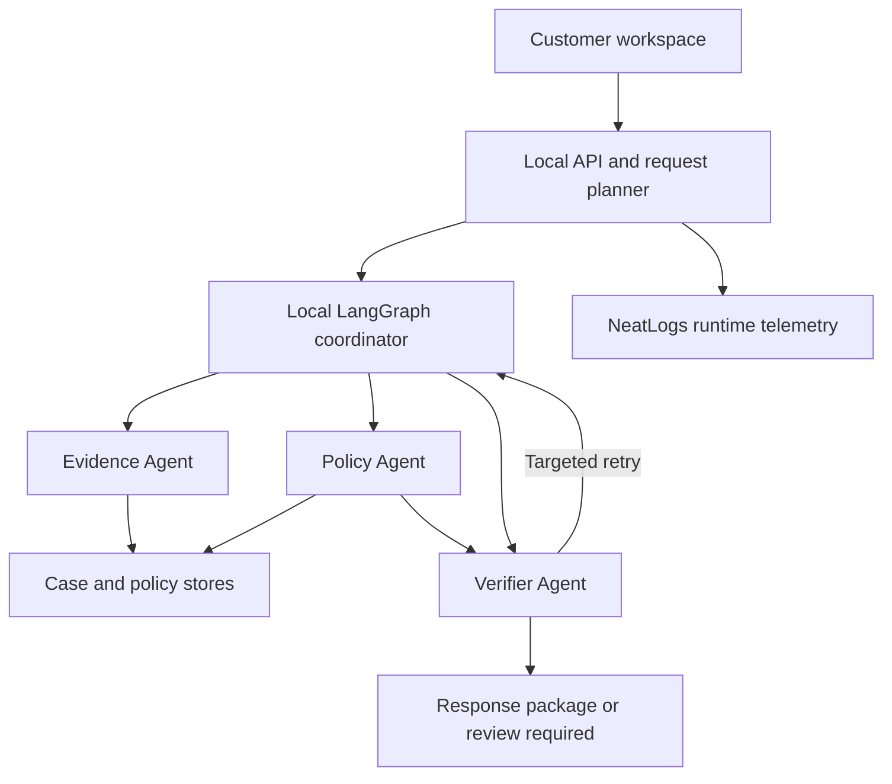

# Health Claim Evidence Assistant

*Plan 1 architecture and implementation specification*

Version 2.0 \| 10 October 2026 \| Localhost implementation baseline

### Purpose and decision

Build a health insurance claim assistant that reconciles insurer queries with a customer’s documents and policy, identifies evidence gaps, and produces a verified response package. The selected design uses three specialist agents under a persistent LangGraph coordinator, with a request planner and bounded corrective actions.

This revision retains the finalized problem, three-agent design and four claim workflows, and replaces cloud infrastructure with a localhost build. NeatLogs, Entire, cfo.ai and Crustdata have distinct integration roles. This is a researched implementation specification; no account connection, application deployment or measured accuracy is claimed.

### Finalized problem statement

A health insurance customer believes the information and documents submitted for a claim are correct and complete. The insurer may still request additional evidence, repeat a request, apply deductions, reject the claim or settle a lower amount. The customer needs to understand what is actually missing, what was already submitted, which policy wording is relevant, and how to respond with traceable evidence.

The core difficulty is a mismatch between the customer’s understanding, the available evidence, the insurer’s stated requirements and the applicable policy. The system must investigate that mismatch without assuming either party is correct.

### What completion means

An analysis is complete when every insurer request has an evidence-backed finding or an explicit unresolved status, and the customer receives an explanation, next actions, a response draft and an attachment manifest. Insurer approval and payment are external outcomes and are not the application’s completion criteria.

### Reading guide

| **Sections**     | **Content**                                                   |
|------------------|---------------------------------------------------------------|
| Foundation       | Problem, scope, workflow, state and stack                     |
| Claim experience | Agent tools, four scenarios, customer examples and UI         |
| Local build      | Processes, account inference, setup and integration contracts |
| Partner use      | Tracing, checkpoints, financial planning and company research |
| Delivery         | Evaluation, documentation coverage and official sources       |

Design principle: evidence determines the next action. Missing records, unreadable text and conflicting versions must remain visible rather than becoming confident conclusions.

## Scope and requirements

### Users and operating model

The customer uploads a policy, claim documents, insurer correspondence and any submission acknowledgements. An authorized reviewer handles unresolved issues within the same application. In a customer-facing deployment this reviewer may be a claims support professional; in an insurer deployment the role may belong to an authorized insurer employee. Access and authority must be configured for the chosen deployment.

| **Area**                | **Included in the minimum viable product**                                                             |
|-------------------------|--------------------------------------------------------------------------------------------------------|
| Completeness            | Compare each insurer request against available document contents and requirements.                     |
| Repeated requests       | Compare scope, document version and acknowledgement evidence before identifying a potential duplicate. |
| Coverage and deductions | Explain cited policy provisions and the insurer’s stated deductions; expose unresolved assumptions.    |
| Disputes                | Prepare an evidence-backed clarification or reconsideration draft for review.                          |
| Recovery                | Resume interrupted analyses and take bounded corrective actions.                                       |
| Deliverable             | A structured report, response draft, evidence references and attachment manifest.                      |

### Required inputs

- Insurer query, rejection letter or settlement communication, with a claim reference where available.

- Policy schedule, wording and relevant endorsements, including version and effective dates.

- Clinical and billing records supplied for the case; retain the original files and page mapping.

- Acknowledgements, portal receipts or other records supporting submission to the insurer.

### Output contract

Each insurer request receives a status: satisfied, partially_satisfied, not_found_in_available_records, unreadable or conflicting_evidence. “Satisfied” means the available evidence supports the specified request; it does not mean the insurer has accepted the document. Submission is tracked separately as confirmed_by_receipt, customer_reported or not_established.

The final package includes the insurer’s request, finding, source references, policy context where relevant, unresolved issues, next action and a reviewable response draft. The package must identify which source versions were used.

### Boundaries

The MVP does not promise claim approval, diagnose disease, establish fraud or replace insurer adjudication. Full settlement computation, insurer portal submission and live claim-status synchronisation require separately authorized integrations and validated rules. Earlier percentage estimates are not measured product performance and are not acceptance criteria.

## Architecture and execution flow

The coordinator owns task state, access boundaries, retry limits and completion. The planner converts an insurer communication into structured tasks. Specialist agents may choose among their allowed tools; the coordinator constrains the workflow and records the result of every action.

The coordinator contains the OAuth model adapter and persistent state. The Evidence Agent works with documents and receipts; the Policy Agent works with clauses and endorsements; the Verifier checks support and corrective actions. Stores preserve versioned source pages.

Figure 1. Local claim runtime. Model inference and NeatLogs export use outbound network connections. Entire development history and cfo.ai / Crustdata business workflows sit outside this claim graph.

1. Intake: authenticate the user, create a case, preserve original files, assign document versions and record SHA256 hashes.

2. Extract: use native PDF text first; route scanned or unusable pages to OCR. Store text with original document and page references.

3. Plan: split the insurer communication into atomic requests and required evidence. Create tasks with dependencies and completion conditions.

4. Investigate: the Evidence Agent examines case records and receipts; the Policy Agent retrieves applicable wording when the task needs policy interpretation.

5. Verify: validate source references and identifiers, inspect contradictory evidence, and test whether the explanation is supported.

6. Act on the result: perform one targeted evidence correction per task when justified; otherwise complete the task or route it for review.

7. Package: check that every task has a status, persist the report version, and produce the response draft and attachment manifest.

The planner is a structured-output step, not an additional unrestricted agent. Evidence and policy work can run independently when their inputs are ready. Verification waits for the findings it must check.

## State persistence and recovery

| **State group** | **Fields and purpose**                                                                                                   |
|-----------------|--------------------------------------------------------------------------------------------------------------------------|
| Identity        | case_id, run_id, tenant_id, user_id, thread_id and trace_id; keep business identity separate from telemetry identifiers. |
| Input versions  | Document IDs, hashes, policy version, endorsement IDs and insurer-request version.                                       |
| Task plan       | request_id, task_id, dependencies, required evidence, status, next action and completion condition.                      |
| Findings        | Evidence references, policy references, submission status, unresolved facts and explanation.                             |
| Control         | retry_count, tool-call budget, elapsed-time budget, checkpoint and review status.                                        |
| Outputs         | report_id, report version, attachment manifest and link to the originating run.                                          |

### Persist and resume

Save completed node outputs and task transitions using the graph checkpointer and application records. A run keeps one stable thread identifier across retries and process restarts. A new analysis of changed inputs receives a new run identity linked to the previous report. NeatLogs session identifiers are not application checkpoint identifiers.

A worker restart should resume unfinished work without recreating completed reports. Use stable operation keys for extraction and report generation. Queue retries alone do not guarantee idempotency: the application must check committed operation results before repeating side effects.

| **Observed condition**         | **Next action**                                       | **Stop condition**                                         |
|--------------------------------|-------------------------------------------------------|------------------------------------------------------------|
| Text extraction fails          | Try OCR for affected pages.                           | Still unreadable: request a better copy or review.         |
| Transient model or tool error  | Use a small bounded transport retry with backoff.     | Budget exhausted: persist failure and expose retry status. |
| Relevant evidence absent       | One targeted search or alternate page/version lookup. | No support: mark not found; do not invent evidence.        |
| Conflicting versions           | Compare version metadata and original pages.          | Unresolved conflict: reviewer required.                    |
| Verifier finds a weak citation | Return a specific read or retrieval action.           | One corrective cycle per task, then review if unresolved.  |

### New evidence and human review

Uploading a replacement document creates a new version. Invalidate affected findings and their dependants, retain prior reports, and re-run only the impacted tasks. A reviewer records their decision and rationale against the source versions. Any override remains auditable.

## Technology stack

Run application services on the developer computer. Pin a compatible dependency set at implementation time. External service entitlements and ChatGPT-plan inference eligibility must pass a smoke test before advertising working integrations.

| **Layer**         | **Selected technology**                  | **Responsibility**                                                                                     |
|-------------------|------------------------------------------|--------------------------------------------------------------------------------------------------------|
| Interface         | React, TypeScript, Vite                  | Claim workspace, evidence report and reviewer view.                                                    |
| Backend           | Python 3.12, FastAPI                     | Authentication boundary, case APIs and job submission.                                                 |
| Schemas           | Pydantic                                 | Validate task plans, tool inputs, findings and reports.                                                |
| Orchestration     | LangGraph                                | Conditional routing, shared state and persistent execution.                                            |
| Language model    | ChatGPT-plan OAuth Responses adapter     | Conditional eligible localhost OSS flow; choose an account-visible model. No purchased OpenAI API key. |
| PDF and OCR       | PyMuPDF, Tesseract                       | Native extraction and fallback for scanned pages.                                                      |
| Embeddings        | BAAI/bge-small-en-v1.5                   | Local retrieval baseline; evaluate on representative English case documents.                           |
| Vector retrieval  | Chroma                                   | Case-scoped evidence and policy chunk retrieval.                                                       |
| Records           | SQLite and SQLAlchemy                    | MVP metadata, tasks, findings and reports.                                                             |
| Graph persistence | SQLite LangGraph checkpointer            | Persist node state and resume interrupted runs.                                                        |
| Jobs              | Redis and RQ                             | Background extraction and analysis workers.                                                            |
| Files             | Private local filesystem volumes         | Originals, extracted pages and versioned reports; backups remain local.                                |
| Observability     | NeatLogs Python SDK and developer MCP    | Runtime traces, evaluation and debugging.                                                              |
| Development       | Git and Entire CLI                       | Code history and AI coding-session checkpoints.                                                        |
| Business planning | cfo.ai remote MCP and CSV import         | Aggregate cost, revenue and runway scenarios.                                                          |
| Business research | Crustdata company REST API               | Separate pilot-market research; never medical or fraud adjudication.                                   |
| Packaging         | Local Docker Compose or native processes | Reproducible localhost build; AWS deferred.                                                            |

SQLite is an MVP choice for modest concurrency. Keep writes short and handle contention explicitly. A larger deployment should move shared application records and checkpoint persistence to a suitable production database. Credentials stay on the server; the browser receives only authorized application data.

## Agent tools and data contracts

These are custom application tools to implement. They are not insurance features supplied by NeatLogs, Entire or cfo.ai. Start with typed Python functions; expose MCP only if independent clients need the same capability.

| **Owner** | **Tool**             | **Purpose**                                                                |
|-----------|----------------------|----------------------------------------------------------------------------|
| Evidence  | list_documents       | List authorized case documents with type, version and extraction state.    |
| Evidence  | search_case_evidence | Retrieve relevant chunks within the authorized case.                       |
| Evidence  | read_page            | Read the original page or its mapped extracted text.                       |
| Evidence  | find_receipts        | Find acknowledgements relevant to a document and submission event.         |
| Evidence  | compare_versions     | Inspect content differences and whether versions satisfy the same request. |
| Policy    | search_policy        | Retrieve applicable clauses using policy/version filters.                  |
| Policy    | read_clause_context  | Read surrounding wording, definitions and exceptions.                      |
| Policy    | get_endorsements     | Retrieve policy amendments relevant to the task.                           |
| Verifier  | validate_source_refs | Check document, version and page references exist and are accessible.      |
| Verifier  | check_identifiers    | Compare claim, member and document identifiers; surface mismatches.        |

### Common tool contract

The backend derives tenant and user authorization from the authenticated session. The model supplies the request-specific arguments; it cannot enlarge its own access scope. Return structured status, data, source references, input versions and a retryable flag. Distinguish an empty result from an access error, timeout or extraction failure.

### Finding contract

A finding contains request_id, evidence_status, submission_status, explanation, evidence_refs, policy_refs, unresolved_questions, next_action and review_required. Each evidence reference includes document_id, version, page and the supporting text span where available. Avoid an uncalibrated percentage confidence score.

### Verifier contract

The verifier returns supported, needs_targeted_action or requires_review, with reasons and a permitted corrective action. An accessible citation proves the source exists; a separate entailment check must establish that the source supports the claim. Schema validation alone cannot establish factual correctness.

### Budgets

Enforce configurable limits on retrieved pages, tool calls, model output and total job time. Keep the planned single corrective evidence cycle separate from transient transport retries. If the remaining evidence cannot resolve a task within budget, return the unresolved state transparently.

## NeatLogs integration

### Runtime tracing through the SDK

Initialize the SDK separately in the API and worker processes. Attach one langchain_handler per graph run where LangChain callbacks apply. The custom OAuth adapter needs its own model span because an arbitrary HTTP call is not automatically a LangChain model. Avoid shared session IDs across unrelated analyses. \[S2, S14\]

Our instrumentation should capture run ID, agent/node name, tool status, source-version references, duration, retries, token usage and supported cost measurements. Wrap extraction and other work outside graph callbacks with appropriate spans. Avoid duplicate instrumentation of the same model call.

### Developer access through MCP

Use https://ingest.neatlogs.com/mcp with the project API key as a bearer token; match the SDK ingestion host. Keep this connection in the developer environment. \[S3\]

| **Official tools**                             | **Use in this project**                                |
|------------------------------------------------|--------------------------------------------------------|
| ping and whoami                                | Verify connectivity and project scope.                 |
| search_traces and get_trace_context            | Find a problematic run and inspect its execution tree. |
| list_detections and get_detection_trend        | Inspect available detections and changes over time.    |
| triage_list and triage_get                     | Read tracked problems and proposed corrective work.    |
| triage_get_investigation and triage_list_steps | Inspect investigation evidence.                        |
| triage_update_status                           | Record reviewed progress after fixing and testing.     |

These are documented tools. triage_accept changes the fix workflow status; it is not a code deployment operation. The SDK is the primary runtime export path; avoid logging the same run again through log_trace. \[S4\]

### Quality evaluation

Use local labelled fixtures, deterministic citation checks and human review as the baseline evaluation. NeatLogs AI and human evaluators are optional enhancements, subject to their provider configuration and account access. Do not assume a ChatGPT subscription supplies a NeatLogs evaluator credential. \[S5, S6\]

Our rubric checks evidence support, version correctness, submission accuracy, policy applicability, explicit uncertainty and useful next actions. Store expected answers for synthetic cases separately from the agent’s outputs. Compare a baseline run with the fixed run using the same inputs.

### Data minimisation

Use synthetic demo documents. For sensitive operation, minimise exported text and apply local SDK masking before export. Server-side redaction is a separate control. Neither should be assumed to transform every separate product API request. \[S7\]

## Entire and cfo.ai integration

### Entire for development history

Enable the official Entire CLI in the Git repository. Use entire enable, entire status --json, entire checkpoint list and entire checkpoint explain \<id\>, subject to the installed version’s help. It records AI coding sessions associated with Git checkpoints. No official Entire MCP endpoint was verified in the reviewed documentation. \[S8\]

Record the development session that implements document-version comparison or repairs a retrieval failure. Link the relevant commit/checkpoint from the project evidence index. Entire checkpoints preserve development context; the LangGraph checkpointer preserves customer workflow state.

Use synthetic fixtures in recorded sessions. Entire transcripts can contain prompts, tool interactions and file contents, so ignoring a patient file in Git does not prevent recording its contents if the coding agent reads it. \[S9\]

### cfo.ai for business planning

Connect a business-planning MCP client to https://api.cfo.ai/mcp and authenticate through the documented browser flow. Select the intended workspace using list_orgs and org_id where needed. The client can change the live financial model, so create an alternative Scenario for experiments. \[S10\]

Read relevant guidance with inspect_skills and inspect the model before editing. Use inspect_table_blocks and edit_table_blocks for inputs and formulas; inspect_scenarios and edit_scenarios for alternatives; inspect_pages and edit_pages for the report. Follow the actual action-block schemas. \[S11\]

| **Model input**                    | **Measured or assumed**                                   |
|------------------------------------|-----------------------------------------------------------|
| Completed analyses and review rate | Measured in application records.                          |
| Inference, OCR and hosting cost    | Measured where available; assumptions labelled.           |
| Review minutes and hourly cost     | Observed review time and an explicit staffing assumption. |
| Price, customer volume and growth  | Business assumptions for scenarios.                       |
| Opening cash and fixed expenditure | Explicit financing and operating assumptions.             |

Calculate expected review cost per analysis from review probability, review duration and hourly cost. Combine it with model, OCR and infrastructure cost to estimate contribution. Forecast monthly revenue, cash movement and runway; if cash does not run out within the forecast horizon, state that instead of inventing a finite runway.

Compare baseline, higher-review and improved-retrieval assumptions. cfo.ai supports scenario comparisons. Import aggregate CSV metrics or update the model through MCP; CSV uploads do not automatically refresh. The export bridge is code we build, not a verified native NeatLogs connector. \[S12, S13\]

## Completeness and repeated requests

### Scenario 1 Document completeness uncertainty

Trigger: the customer believes a claim is complete, but the insurer asks for a final discharge summary. The available file is titled “Discharge Summary” and contains provisional wording.

1. The planner creates a task for the final summary and records the insurer’s exact requested scope.

2. The Evidence Agent lists candidate documents, reads the relevant pages and identifies the provisional designation.

3. It searches for a newer version and compares candidates. A matching filename alone does not establish completeness.

4. The verifier checks the source and the reasoning. If only the provisional version exists, the task is partially satisfied or missing for the requested final version.

5. The report explains which document is available, what differs, and what the customer should obtain. The draft asks for the final signed version or clarification of the required content.

Branch: final version found → validate contents and identifiers → mark evidence satisfied. No final version → state the gap. Unreadable designation → OCR or human review. Submission remains a separate finding.

Customer output example: “The available summary is marked provisional on page 1. We could not find a final version in this case. Obtain the final summary and retain the submission acknowledgement.” This is an illustrative product response, not a real claim determination.

### Scenario 2 Repeated document requests

Trigger: the insurer asks again for an itemized bill. The customer has a bill and an acknowledgement, but the acknowledgement may refer to an earlier submission.

1. Normalize the new request and compare it with prior requests, including requested date range, signatures and document version.

2. Read the bill and locate receipts. Match acknowledgement details to the actual file or submission event where possible.

3. If the exact required evidence and matching acknowledgement are present, prepare a clarification citing both.

4. If only upload evidence exists, explain that receipt by the insurer is not established. If a revised bill is required, explain why the new request is materially different.

5. The verifier blocks any claim of confirmed submission unsupported by the receipt.

Branch: same scope + matching evidence + receipt → potential duplicate with proof. Same file but no receipt → evidence available, submission unconfirmed. Changed scope/version → additional requirement. Ambiguous receipt → review.

Reviewer action: confirm the correspondence and attachment mapping, then approve or edit the draft. Sending it to an insurer is a separate user-authorized action.

## Coverage and dispute workflows

### Scenario 3 Coverage and deduction confusion

Trigger: a settlement communication lists a deduction that the customer does not understand. Inputs include the bill, settlement breakdown, schedule, policy wording and endorsements.

1. The planner creates one task per deduction or coverage question, preserving the insurer’s stated reason.

2. The Evidence Agent extracts billed and settled amounts, dates and the disputed line items.

3. The Policy Agent retrieves the cited provision plus definitions, exceptions, schedule terms and relevant endorsements.

4. The verifier checks that the policy version applies and that the explanation follows the actual clause. Deterministic arithmetic checks may validate stated totals.

5. The report separates the insurer’s stated reason, the supporting wording, any missing explanation and the customer’s next action.

Branch: applicable wording clearly supports the stated explanation → explain with citations. Relevant exception or conflicting endorsement → flag for review. Missing breakdown → draft a request for itemized reasoning. Ambiguous facts → preserve the uncertainty.

Completion: every disputed item receives an explanation or an explicit information gap. The MVP does not claim to reproduce the insurer’s complete adjudication engine or guarantee a recoverable amount.

### Scenario 4 Rejection or short settlement dispute

Trigger: the customer disputes a rejection or payment below the claimed amount. The system needs the decision letter, timeline, policy and evidence supporting the customer’s position.

1. Extract each rejection or deduction reason into a separate issue. Build a dated evidence timeline.

2. Map the available facts and documents to each reason. Separate customer statements from documentary support.

3. Retrieve relevant policy wording and identify discrepancies, missing justification or unresolved factual questions.

4. The verifier checks every factual statement in the proposed response and removes unsupported accusations or promises.

5. Generate a reconsideration or clarification draft with source references and an attachment manifest; route substantive uncertainty to the reviewer.

Branch: a documented discrepancy exists → draft a supported challenge. A required record is absent → specify what must be obtained. The available evidence supports the insurer’s stated position → explain it accurately. Unresolved conflict → request human review.

Completion: a reviewable dispute package, not an assurance of reversal. Escalation routes and filing deadlines must be verified for the actual policy and jurisdiction before they are included in a live response.

## Customer examples and sensitive cases

The four examples below are synthetic acceptance scenarios. They illustrate how the architecture behaves; they are not online case studies, medical advice or conclusions about coverage for a diagnosis. Coverage depends on the actual policy, facts and applicable requirements.

### Customer 1 Diabetes

Example query: the insurer asks for earlier treatment records or clarification of a declaration. The Evidence Agent compares the proposal declaration, available history and insurer request. The Policy Agent retrieves the relevant wording and endorsements. The verifier checks dates and the distinction between a documented diagnosis, a customer recollection and missing records.

Flow: query → declaration and timeline review → relevant policy context → source verification → supported explanation or records request. A mismatch triggers clarification; the system must not infer intentional non-disclosure from the diagnosis alone.

### Customer 2 Dengue

Example query: the insurer requests a final discharge summary or a laboratory report. The Evidence Agent locates the supplied reports, checks identifiers and versions, and examines acknowledgement evidence. The Policy Agent is invoked only for policy-dependent questions. The verifier checks whether the exact requested evidence is present.

Flow: document request → report and version retrieval → receipt check → verification → existing-evidence response or missing-document action. An absent test result is recorded as absent in the available records; the system must not infer that a particular test is universally required.

### Customer 3 HIV

Example query: a rejection communication cites a coverage provision. Restrict access to the necessary records. Retrieve the specific policy clause, schedule and endorsements; compare the insurer’s reasoning with the supplied evidence. Route unclear policy applicability or legal interpretation to a qualified reviewer.

Flow: reason extraction → restricted evidence review → policy and endorsement review → verification → confidential explanation and reviewable clarification draft. The diagnosis alone must not produce an automatic exclusion or a fraud flag.

### Customer 4 Suspected manipulation

Example trigger: two versions of an invoice have different totals or identifiers. Preserve both originals, compare versions and inspect the apparent discrepancy. An OCR error or legitimate corrected invoice may explain the difference. Hashes help detect file changes but do not establish authenticity or intent.

Flow: discrepancy detected → source-page comparison → identifier and timeline check → explanation sought → authorized human review. Label the outcome “inconsistent evidence requiring review,” not “fraud confirmed.” External hospital verification requires an authorized channel and is outside the default MVP.

Across all examples, the same evidence statuses and verification rules apply. A diagnosis changes which facts may be relevant; it does not replace policy-specific reasoning or prove dishonesty.

## User interface and access controls

### Three core screens

| **Screen**           | **Main contents**                                                                               | **Key actions**                                                       |
|----------------------|-------------------------------------------------------------------------------------------------|-----------------------------------------------------------------------|
| 1 Claim workspace    | Policy, insurer query, document inventory, extraction states and task progress.                 | Upload files, start analysis, add missing evidence and resume a case. |
| 2 Evidence report    | Request-by-request findings, page references, source preview, missing items and response draft. | Inspect a citation, edit the draft and download the package.          |
| 3 Reviewer workspace | Assigned cases, conflicts, source versions, verifier reasons and decision history.              | Approve a finding, request evidence or record a reasoned override.    |

Login, access-denied, loading and error views are supporting states rather than additional core screens. Keep technical traces in the developer environment; show customers clear progress and actionable explanations.

### Proposed application endpoints

Use application endpoints for creating cases, uploading versioned documents, starting an analysis, reading progress, fetching reports and recording reviewer decisions. Proposed paths include POST /cases, POST /cases/{id}/documents, POST /cases/{id}/analyses, GET /analyses/{run_id}, GET /reports/{id} and POST /tasks/{id}/review. These are our API design, not sponsor APIs.

### Access and evidence protection

- Enforce tenant and case authorization before every database, vector or file read. Do not trust model-supplied case identifiers as authorization.

- Store original files separately from derived text and generated drafts. Preserve page mapping and source versions.

- Treat uploaded text as untrusted evidence. Instructions embedded in documents cannot change tool permissions or the system task.

- Keep keys and provider credentials in server-side configuration. Avoid secrets and patient data in public repositories or build posts.

- Restrict reviewer permissions and record who changed a finding, when and why. Keep customer-visible findings separate from restricted investigation notes.

- Use synthetic public-demo data. Establish retention, deletion and access policies before any real deployment.

### Customer control

The customer can inspect the source behind a finding, correct or add evidence, review the response and download it. Automatic external submission is outside the baseline. A reviewer may finish an analysis with a documented unresolved issue; this must remain visible in the package.

## Evaluation and acceptance criteria

Use a small labelled test collection covering ordinary and adverse cases. A proposed starting set is 20 synthetic cases across the four core scenarios, with overlapping failure conditions. This is a development benchmark, not a statistically representative estimate of insurance outcomes.

| **Test**                          | **Acceptance behaviour**                                                          |
|-----------------------------------|-----------------------------------------------------------------------------------|
| Final versus provisional document | Do not mark a provisional document as satisfying a request for the final version. |
| Upload without acknowledgement    | Never claim confirmed insurer receipt from local upload metadata alone.           |
| Policy amendment                  | Apply relevant endorsement context or surface uncertainty.                        |
| Unreadable scan                   | Use extraction fallback; disclose unreadable evidence if fallback fails.          |
| Wrong case or member              | Reject unauthorized access and flag relevant identity mismatches.                 |
| Unsupported citation              | Block the conclusion or request a targeted correction.                            |
| Worker interruption               | Resume from persisted progress without duplicate final artifacts.                 |
| New document version              | Retain the old report and recompute affected findings.                            |
| Conflicting invoice               | Preserve originals and route unresolved inconsistencies to review.                |
| Prompt injection in document      | Continue the case task without executing embedded instructions.                   |

### Metrics to record

- Request-status accuracy against labelled expected findings, with counts and a confusion matrix.

- Unsupported-conclusion rate and citation-support rate, evaluated on material claims.

- False duplicate-request rate and false confirmed-submission rate.

- Completion and recovery rates for the explicitly defined test conditions.

- Latency, model usage/cost, tool calls, retry count and human-review rate.

Report numerator, denominator, dataset version, model version and prompt/code version. Separate automatic completion from completion requiring human review. Do not convert a small synthetic benchmark into a claim that the system solves a percentage of all customer problems.

### Before and after experiment

Use the same inputs to compare a baseline that confuses provisional and final documents with the corrected version. Record whether the finding changed correctly and whether cost or latency changed. Inspect the linked NeatLogs traces and Entire checkpoint. Rerun the broader small benchmark to check that the fix did not break previously correct cases.

### Release gate

The MVP is demo-ready when the complete package is generated, critical access and evidence checks pass, at least one recovery path works, and every advertised integration has verifiable evidence. Record remaining failures explicitly.

## Hackathon alignment and build sequence

| **Judging category**       | **Weight** | **Planned evidence**                                               |
|----------------------------|------------|--------------------------------------------------------------------|
| Agent                      | 30%        | Completed response package, adaptive routing and failure recovery. |
| Partner usage              | 25%        | NeatLogs runs, Entire checkpoint and cfo.ai business plan.         |
| Demo                       | 20%        | A clear recording of the task, execution and result.               |
| Building in public         | 15%        | Links to progress, failure/fix and launch posts.                   |
| Usefulness and originality | 10%        | Request reconciliation and submission proof on a concrete case.    |

The weights and evidence expectations come from the official hackathon page. All three partner tools need demonstrable roles; improvement and recovery claims need inspectable runs. Code must be authored during the permitted build window. Check the official page and Discord for submission updates. \[S1\]

### Eight focus areas translated into checks

Planning: inspect the request task list. Tool use: inspect real calls. State: restart and resume. Context: inspect relevant source versions. Execution: finish every task. Recovery: demonstrate a failed action and response. Verification: block an unsupported finding. Iteration: show a result causing a targeted next action. These are design commitments until demonstrated.

### Implementation order

1. Create the repository during the allowed window, enable Entire, and establish synthetic fixtures and typed contracts.

2. Implement one vertical slice: upload → extract → evidence search → verified finding → report. Instrument it with NeatLogs immediately.

3. Add policy retrieval, request planning and the four scenario branches. Keep the planner and tool budgets bounded.

4. Add persistent checkpoints, recovery, version invalidation and the reviewer workflow. Test a worker restart.

5. Run the evaluation collection, repair a documented failure and retain comparable traces plus the related development checkpoint.

6. Populate cfo.ai with aggregate metrics and explicit assumptions. Include pricing, costs, revenue and cash runway.

7. Prepare the public repository, evidence index, build posts and demo. Demonstrate one complete synthetic case with a meaningful recovery branch.

### Submission evidence index

The repository should link the architecture description, setup instructions, synthetic input fixture, expected result, baseline and improved traces, Entire checkpoint, cfo.ai plan, demo and public-build posts. Disclose mocked integrations and measured versus assumed figures.

Remaining local checks: OS and available memory, package compatibility, ChatGPT OAuth entitlement and model catalog, sponsor project/workspace access, and reviewer role. Deployment architecture is deferred. No accuracy score, financial forecast or integration success is claimed by this document.

## Localhost topology and storage

Localhost describes where the application runs, not an offline promise. Claim processing, records, retrieval and report generation stay local; selected model inputs leave the machine for authorized inference, and minimized traces go to NeatLogs. The business workflow connects separately to cfo.ai and Crustdata.

| **Process**    | **Local address / storage**         | **Role**                                                          |
|----------------|-------------------------------------|-------------------------------------------------------------------|
| Browser UI     | http://127.0.0.1:5173               | Three core views; Vite development server.                        |
| FastAPI        | http://127.0.0.1:8000               | Case APIs, authenticated local sessions and job status.           |
| RQ worker      | No public listener                  | One analysis at a time initially; owns extraction and graph runs. |
| Redis          | Loopback 6379                       | Job transport only; not the authoritative claim record.           |
| SQLite         | data/app.sqlite; checkpoints.sqlite | Separate application and graph records; short writes.             |
| Chroma + files | data/chroma; cases; reports         | Persisted vectors, source versions and outputs.                   |

### Recommended development environment

Use Python 3.12, Node LTS, Git, Docker Compose and Tesseract. On Windows, use WSL2 for the backend, OCR and worker; run the browser normally. An initial engineering target is 8 GB RAM with enough disk for fixtures and model downloads, to validate on the actual laptop. No local GPU is needed for the selected remote LLM path.

Provide bind-mounted or named volumes for durable data. Bind published ports to 127.0.0.1; never publish Redis or a raw document directory to the network. Browser requests go through authorized FastAPI endpoints. Configure an exact UI origin, local login and file-size limits. Use a consistent hostname so cookies and OAuth callbacks do not drift.

### Local durability and shutdown

Commit task outcomes before publishing completion events. Persist document hashes, graph checkpoints and output manifests; Redis alone is insufficient. A lost queue is repaired by re-enqueuing unfinished database jobs with stable operation keys. Close the worker gracefully, finish or cancel streams, drain telemetry, then stop Redis and the API. Back up local volumes while database writers are quiescent.

AWS, Bedrock, S3, managed databases, load balancers and cloud deployment automation are outside this revision. Later deployment needs a separate infrastructure and data-handling review; this document creates no AWS dependency.

## ChatGPT-plan model adapter

Respect the request to avoid purchased OpenAI API-key credits. The proposed route is the official Sign in with ChatGPT plan-usage flow for eligible open-source, locally hosted applications. Availability must be verified for the actual account, workspace and app; a Plus subscription is not an unlimited API-credit pool. Paid or remotely hosted use follows a separate eligibility path. \[S24\]

### Authorization and account ownership

Implement a backend-owned loopback OAuth callback with PKCE, state and OIDC nonce validation. Persist one opaque ext_agent_host_id per installation. Initial registration uses dynamic_agent_client; save and reuse the issued client_id, not that bootstrap value. This route requires no client secret or partner API key. \[S25\]

Keep tokens in the operating-system credential store, scoped to the chosen account/workspace. The browser receives connection status, not bearer credentials. Request the documented identity and plan-usage permissions explicitly; validate the returned identity and grants before activating the account. Revocation, account switching and expiry must pause or reauthorize the correct run.

### Inference contract

Discover available models using the OAuth credential at /v1/models; display account-visible names and send the selected slug. Use the public https://api.openai.com/v1/responses endpoint with the OAuth bearer token, store=false and stream=true. Treat a completed response event as success; a partial stream is not a finding. In the Python SDK, api_key can hold this OAuth token: it is not a purchased API key. \[S26\]

Our adapter returns validated content or a typed failure, usage when provided, latency and completion status. The graph owns history, source selection and tool execution. Execute only allowlisted local functions, check their arguments and access scope, then send tool results with the next bounded request. No model gets shell access to the case directory.

### Preview compatibility and failure handling

Send explicit input history and developer instructions. Do not rely on previous_response_id, hosted MCP, hosted file search or Code Interpreter on this route. Omit unsupported fields including temperature, max_output_tokens and max_tool_calls. The supported function/custom-tool format must follow the current namespace or additional_tools contract. \[S27\]

Enforce job time, history size and tool-call limits locally. Stop and close an over-budget stream; retain partial text only as diagnostic material. On quota exhaustion or failed authorization, checkpoint the task and show a recoverable pause. Never switch silently to API-key billing. If this entitlement is unavailable, mark the real-LLM path blocked; a labelled deterministic fixture replay can demonstrate UI flow but is not a live-agent result.

## NeatLogs local instrumentation details

### Instrument the actual adapter

Use neatlogs\[langchain\] for graph callbacks and custom spans for extraction, retrieval and verification. Python 3.12 is within the documented SDK range. @neatlogs.span supports workflow, agent, tool and other non-LLM spans; for the custom model call use neatlogs.trace(kind="LLM") rather than an unsupported LLM decorator kind. Configure capture/redaction before any input is exported. \[S14\]

| **Span**          | **Proposed attributes**                               | **Exclude**                         |
|-------------------|-------------------------------------------------------|-------------------------------------|
| Workflow          | Opaque run ID, code/prompt version, completion        | Member identity, raw medical bundle |
| Evidence / Policy | Request ID, document-version IDs, result count        | Full pages unless synthetic         |
| Verifier          | Check outcome, unresolved count, correction reason    | Sensitive free-form identifiers     |
| LLM adapter       | Model slug, duration, usage if returned, stream state | OAuth token and auth headers        |
| Tool              | Tool name, success / empty / retryable failure        | Credentials and unbounded payloads  |

Export sanitized trace correlation rather than patient names. Preserve full audit facts in the local case database. Test masking with deliberately planted identifiers. An export failure should record telemetry_degraded locally and allow evidence processing to continue; do not assume the SDK offers a durable offline replay queue.

### Lifecycle and verification

Batch export is separate from request handling. Do not flush per API request. A worker should stop accepting work, finish active streams/jobs and shut down once. Close a stream before draining telemetry; use bounded deadlines and record potential telemetry loss. Short-lived scripts flush and shut down in finally. \[S15\]

1. Run the documented SDK doctor local/probe checks; these prove configuration/connectivity, not complete agent tracing.

2. Run one synthetic claim and confirm workflow, specialist, tool and manually instrumented model spans appear in the intended project.

3. Compare local run outcome and source versions with the trace; repair duplicate or missing spans.

4. Capture a failure/fix pair using the same fixture and record linked code, prompt and dataset versions.

### Prompt and evaluation choice

Keep prompts and labelled cases in Git for the initial build. Managed prompt versions are optional later. NeatLogs Experiments documents versioned prompts and a BYOK Playground; its trace-derived Datasets feature is marked coming soon. Therefore the MVP runs its own fixture suite through the OAuth adapter and does not depend on that dataset feature or Playground billing. \[S16\]

## Crustdata business research workflow

Use the organizer-provided allocation to investigate potential pilot organizations: claims-support firms, third-party administrators, brokers and employer-benefits businesses. This is a separate administrator workflow, outside Evidence, Policy and Verifier. Company information can inform a market hypothesis; it cannot establish coverage, medical facts, hospital licensing or fraud.

### REST baseline

Use the current versioned API at https://api.crustdata.com with Authorization: Bearer \<server-side key\> and x-api-version: 2025-11-01. Build against this schema consistently; do not mix legacy screener/data_lab examples into it. Company Search selects candidate organizations using documented filters and bounded result limits. \[S17, S18\]

For an ambiguous company, POST /company/identify using exactly one identifier type such as domains or names. Inspect candidate domains and matching metadata before selecting an entity. Identify returns a top-level array and is documented as free; it is entity resolution, not a deep profile. \[S19\]

Enrich only selected, resolved organizations through /company/enrich, requesting the minimum permitted fields for the pilot-market question. Record source entity ID and retrieval date. Detailed profile availability and cost depend on selected fields and account access. \[S20\]

| **Application wrapper**     | **Inputs / output**                      | **Control**                     |
|-----------------------------|------------------------------------------|---------------------------------|
| search_target_organizations | Segment filters → limited candidates     | Admin-only, query budget        |
| identify_organization       | Name/domain → ranked matches             | Ambiguity requires confirmation |
| enrich_organization         | Resolved ID → selected profile fields    | Cache, permitted fields only    |
| get_research_usage          | Account permissions, balance, call usage | Read-only monitoring            |

### Credit and reliability controls

Check GET /account/endpoints before research: it reports enabled endpoints, allowed fields, effective limits and account pricing. GET /account/credits reports the shared remaining balance; both checks are free. The 5,000 credits are the organizer allocation, not a balance verified in this document. \[S21, S22\]

Persist query hashes and results to avoid accidental duplicate spend. Set a small configurable research cap, rate-limit per endpoint, and back off on 429. Permission failures require narrowing the request or stopping, not repeating unchanged. Verify live account limits rather than hardcoding the published defaults. \[S23\]

Output pilot_candidates.csv with company ID, domain, segment, source date and the human rationale for fit. Keep candidate counts distinct from signed customers. Never send claim files, diagnoses or member identifiers to this workflow. No customer contact or outreach is part of this build.

## MCP boundaries and partner handoffs

MCP is useful for developer and business clients; the claim graph does not need to become an MCP client. Sponsor tools do not supply the application’s insurance-evidence functions. Use ordinary typed Python functions in the claim runtime.

| **Service** | **Official interface**                            | **Placement / initial choice**                                         |
|-------------|---------------------------------------------------|------------------------------------------------------------------------|
| NeatLogs    | Python SDK; https://ingest.neatlogs.com/mcp       | SDK in local runtime; developer MCP for trace investigation.           |
| Entire      | Git hooks and CLI                                 | Coding environment; no verified official MCP endpoint.                 |
| cfo.ai      | https://api.cfo.ai/mcp                            | Business-planning client; manual aggregate CSV first.                  |
| Crustdata   | Versioned REST; https://install.crustdata.com/mcp | REST for reproducible research; MCP optional for business exploration. |

Crustdata MCP supports client OAuth and programmatic bearer-key access. Read crustdata://catalog and its tool/schema/cost resources instead of inventing tool names. Its catalog includes a dry-run guide; use it before exploratory scripts. Choose REST or MCP for a research step so the same paid query is not executed twice. \[S28\]

### Entire development evidence

Install the supported release for the OS, enable the relevant coding-agent hooks, and inspect the installed CLI help. With Codex, the documented option is entire enable --agent codex. Commit an implemented fix and inspect the resulting checkpoint; retain its ID and an actually accessible link. \[S8\]

Acceptance: implement a source-version or receipt-matching fix in an Entire-recorded session, link the checkpoint to its code commit, and show the fixed NeatLogs run. Keep synthetic fixtures in coding sessions. Local application restarts resume LangGraph state, not an Entire coding checkpoint.

### cfo.ai financial handoff

Export only monthly totals: analyses, model usage, elapsed time, retries, review count/minutes and research credits. Import the CSV manually or use an authenticated business MCP client after inspecting the live model and schemas. A repeatable Ari Skill can document the aggregate-import and scenario-review process; enabling it changes workspace behavior and is optional. \[S29\]

Separate hackathon cash spend, personal subscription cost allocation, and production inference assumptions. Do not label free event credits or plan quota as permanent zero cost. Use one consistent currency and forecast period. Formula choices below are our proposed business model, not vendor defaults.

- Expected review cost / analysis = review rate × minutes / 60 × hourly reviewer cost.

- Contribution / analysis = unit price − inference − OCR − review − variable infrastructure cost.

- Monthly revenue = paying organizations × monthly fee, plus explicitly modelled usage fees.

- Closing cash = opening cash + collected revenue − cash expenditure; report runway only within the modelled assumptions.

Create base, high-review and low-volume Scenarios and a reviewable business-plan Page. Show measured versus assumed inputs and pilot conversion assumptions. Crustdata prospects inform the hypothesis; they do not count as revenue. Scheduled triggers and financial-system integrations are deferred until the local manual refresh is reliable.

## Local build sequence and interface contracts

These are proposed project paths, commands and endpoints to implement, not files or APIs already created by this documentation update. Maintain a single runnable repository with backend/, frontend/, prompts/, fixtures/, scripts/ and gitignored data/ directories.

| **Step**           | **Implementation result**                              | **Acceptance evidence**                       |
|--------------------|--------------------------------------------------------|-----------------------------------------------|
| 1 Local skeleton   | Compose: API, worker, Redis and UI; persistent volumes | Health endpoint; UI reachable on loopback     |
| 2 Model connection | OAuth callback, keyring and catalog picker             | One completed synthetic inference; no API key |
| 3 Vertical slice   | Upload → extraction → evidence → report                | Page citation opens the original version      |
| 4 Claim logic      | Policy, verifier, correction and reviewer flows        | Four scenario outputs match labelled fixtures |
| 5 Durability       | Checkpoints, operation keys, version invalidation      | Restart worker; no duplicate report           |
| 6 Partner evidence | Traces, checkpoint, business model, research CSV       | Accessible evidence links and measured usage  |

### Proposed backend endpoints

POST /cases creates a case; POST /cases/{id}/documents uploads a version; POST /cases/{id}/analyses schedules work; GET /analyses/{run_id} returns status; GET /reports/{report_id} returns a structured report; POST /tasks/{id}/review records reviewer action. /auth/chatgpt/start and /auth/chatgpt/callback implement the authorized account connection. Gate every case/report endpoint by local user scope.

### Configuration contract

Check in .env.example with placeholders for DATA_DIR, APP_ORIGIN, REDIS_URL, NEATLOGS_API_KEY and CRUSTDATA_API_KEY. Store ChatGPT tokens in the OS keyring rather than the example file. Persist the host ID and account registration separately from transient runs. Leave OPENAI_API_KEY absent. cfo.ai authentication belongs to its business client, not the claim frontend.

The intended start command is docker compose up --build after the repository supplies its Compose file; stop with docker compose down while preserving volumes. Native development may use uvicorn app.main:app --host 127.0.0.1 --port 8000, an RQ worker and npm run dev -- --host 127.0.0.1. These commands require the corresponding proposed modules/package scripts to exist first.

### Local integration acceptance

Test schema validation, citation entailment, receipt matching, mismatched identifiers and prompt injection. Also test OAuth expiry, unavailable model, quota pause, NeatLogs export failure, Crustdata permission/429 failures and cfo CSV schema rejection. Include a complete synthetic dengue case, diabetes/HIV policy uncertainty and an invoice inconsistency routed to review. Record actual outcomes; do not claim 100% coverage.

## Documentation coverage and open decisions

Review scope: official documentation indexes and the relevant setup, SDK, MCP, privacy, model, data, scenario and operational references. This is not a claim that every vendor page was read. Entries below distinguish adopted capabilities from catalogued or deferred features. Research date: 10 October 2026.

| **Resource / documentation area**                          | **Decision**          | **Reason / validation**                                                                                         |
|------------------------------------------------------------|-----------------------|-----------------------------------------------------------------------------------------------------------------|
| NeatLogs SDK, graph integration, lifecycle, masking        | Adopt                 | Trace real local calls; verify redaction and export.                                                            |
| NeatLogs MCP, detections, investigations, fixes            | Developer use         | Investigate and verify a failure/fix; no insurance decisions.                                                   |
| NeatLogs prompts / Playground / Datasets                   | Optional / defer      | Git prompts and local fixtures first; BYOK and coming-soon constraints.                                         |
| Entire CLI, Git hooks, checkpoints, privacy                | Adopt                 | Development provenance and accessible checkpoint proof.                                                         |
| Entire hack-specific guide, Trails, Graph/Brain            | Unverified / optional | Guide could not be retrieved. Features mentioned by organizer; confirm in account before planning dependencies. |
| cfo.ai workspace, MCP, agent instructions, CSV             | Adopt                 | Inspect model; import only aggregates and explicit assumptions.                                                 |
| cfo.ai formulas, scenarios and Pages                       | Adopt                 | Cost/pricing/revenue/runway plan; validate model totals.                                                        |
| cfo.ai Skills, triggers, live connectors, headcount        | Optional / defer      | Manual refresh first; unrelated enterprise workflows excluded.                                                  |
| Crustdata company search / identify / enrich               | Adopt separately      | Pilot-market research; no claim adjudication use.                                                               |
| Crustdata auth, version, permissions, credits, limits      | Adopt                 | Check account entitlement and cap research spend.                                                               |
| Crustdata MCP and CLI                                      | Optional alternative  | Use published catalog/installed help; REST is baseline.                                                         |
| Crustdata people, contact, jobs, social, watchers, batches | Catalogued / defer    | No demonstrated claim need; avoid unnecessary data and callbacks.                                               |
| OpenAI plan usage / OAuth / inference limits               | Conditional adopt     | Actual account smoke test gates the live-LLM build.                                                             |

### Research limits and compatibility checks

The Entire hackathon guide failed retrieval; use its official CLI baseline. Some cfo.ai automation/sharing pages were intermittently unavailable; optional automation needs account-UI confirmation. Verify installed CLI versions, MCP schemas and account entitlements.

Before building, verify machine resources, OSS/inference eligibility, NeatLogs project, cfo.ai workspace/schema, Crustdata permissions and reviewer role. Update dependency pins and evidence after integration tests.

## Official documentation and references

Sources reviewed during this planning conversation. The architecture, contracts, scenarios and acceptance tests are project design choices. Vendor capabilities are attributed below; implementation should confirm the installed versions and account entitlements.

**S1 neatHack rules and judging**

https://neatlogs.com/hackathon

**S2 NeatLogs LangChain and LangGraph integration**

https://docs.neatlogs.com/integrations/langchain

**S3 NeatLogs MCP connection**

https://docs.neatlogs.com/integrations/mcp

**S4 NeatLogs MCP tools reference**

https://docs.neatlogs.com/integrations/mcp-tools

**S5 NeatLogs AI evaluators**

https://docs.neatlogs.com/docs/features/evals/ai-evaluators

**S6 NeatLogs human evaluators**

https://docs.neatlogs.com/docs/features/evals/human-evaluators

**S7 NeatLogs PII redaction and masking**

https://docs.neatlogs.com/sdk/pii-redaction

**S8 Entire official CLI repository**

https://github.com/entireio/cli

**S9 Entire security and privacy**

https://github.com/entireio/cli/blob/main/docs/security-and-privacy.md

**S10 cfo.ai MCP server**

https://docs.cfo.ai/integrations/mcp-server

**S11 cfo.ai agent instructions**

https://docs.cfo.ai/agent-instructions

**S12 cfo.ai scenarios**

https://docs.cfo.ai/scenarios/create-and-compare-scenarios

**S13 cfo.ai data connections and CSV import**

https://docs.cfo.ai/integrations/connect-and-sync-data

**S14 NeatLogs Python SDK**

https://docs.neatlogs.com/sdk/python

**S15 NeatLogs flush and shutdown**

https://docs.neatlogs.com/sdk/lifecycle

**S16 NeatLogs Experiments / BYOK / availability**

https://docs.neatlogs.com/docs/features/experiments

**S17 Crustdata introduction and API version**

https://docs.crustdata.com/general/introduction

**S18 Crustdata Company Search**

https://docs.crustdata.com/company-docs/search/introduction

**S19 Crustdata Company Identify**

https://docs.crustdata.com/company-docs/identify/introduction

**S20 Crustdata Company Enrich**

https://docs.crustdata.com/company-docs/enrichment/introduction

**S21 Crustdata permissions**

https://docs.crustdata.com/general/permissions

**S22 Crustdata credit balance**

https://docs.crustdata.com/general/credits

**S23 Crustdata rate limits**

https://docs.crustdata.com/general/rate-limits

**S24 OpenAI ChatGPT plan usage overview**

https://developers.openai.com/siwc/token-sharing-open-source

**S25 OpenAI registration and sign-in**

https://developers.openai.com/siwc/token-sharing-open-source/sign-in

**S26 OpenAI models and inference**

https://developers.openai.com/siwc/token-sharing-open-source/models-and-inference

**S27 OpenAI plan usage preview limitations**

https://developers.openai.com/siwc/token-sharing-open-source/preview-limitations

**S28 Crustdata MCP server and catalog**

https://docs.crustdata.com/for-agents/mcp

**S29 cfo.ai repeatable Skills**

https://docs.cfo.ai/automation/skills

**S30 Crustdata documentation index**

https://docs.crustdata.com/llms.txt

**S31 Crustdata pricing**

https://docs.crustdata.com/general/pricing

**S32 Crustdata CLI**

https://docs.crustdata.com/for-agents/cli

**S33 Entire hackathon guide (retrieval unavailable)**

https://hack.entire.io/neathacks-2026/

**S34 NeatLogs hackathon setup guide**

https://neatlogs.com/hackathon/neatlogs-setup-guide.html

The customer examples are illustrative fixtures rather than sourced legal or clinical case studies. No empirical success percentage or verified novelty claim is asserted. Any future legal, clinical or insurer-specific claims need their own current primary sources.
